# Monitoreo de red con Zabbix y SNMP de solo lectura.

## Video demostrativo.

> Enlace directo: https://www.youtube.com/playlist?list=PLVyr9nXEe03Y

| | |
|---|---|
| **Estudiante** | Angel Alcantara |
| **Matrícula** | 2024-2356 |
| **Institución** | Instituto Tecnológico de Las Américas (ITLA) |
| **Plataforma** | PNETLab |
| **Herramientas** | Cisco IOL, Cisco IOL L2, Ubuntu Server 20.04, Zabbix 6.0 LTS, Kali Linux |

---

## Contenido

1. [Propósito del laboratorio](#1-propósito-del-laboratorio)
2. [Topología](#2-topología)
3. [Dispositivos y conexiones](#3-dispositivos-y-conexiones)
4. [Direccionamiento IP](#4-direccionamiento-ip)
5. [Configuración del router R-ZBX](#5-configuración-del-router-r-zbx)
6. [Configuración del switch SW-ZBX](#6-configuración-del-switch-sw-zbx)
7. [Servidor Zabbix](#7-servidor-zabbix)
8. [Verificación](#8-verificación)
9. [Prueba de seguridad](#9-prueba-de-seguridad)
10. [Problemas encontrados y solución](#10-problemas-encontrados-y-solución)
11. [Estructura del repositorio](#11-estructura-del-repositorio)
12. [Anexos: running-configs y scripts](#12-anexos-running-configs-y-scripts)

---

## 1. Propósito del laboratorio

El objetivo es implementar el **monitoreo seguro** de los equipos de red de una LAN usando **Zabbix** y **SNMP**. Para eso se configuró:

- **Direccionamiento IP** en el router y el switch, basado en la matrícula (`10.23.56.0/24`).
- **Servidor DHCP** en el router para la red LAN, con una **reserva** para que el servidor Zabbix (cliente DHCP) reciba siempre la misma IP.
- **Comunidad SNMP de solo lectura (RO)** en el router y el switch.
- **Servidor Zabbix** como cliente DHCP, que consulta por SNMP los datos del router y el switch.

Desde el punto de vista de **seguridad de redes**, la comunidad SNMP está amarrada a una **ACL estándar** que solo permite al servidor Zabbix (`10.23.56.20`). Así se cumple que:

1. El monitoreo funciona únicamente desde el servidor autorizado.
2. Nadie puede modificar la configuración de los equipos por SNMP (solo lectura).
3. Cualquier otro equipo de la red que intente consultar SNMP es bloqueado, **aunque conozca la comunidad**, y el intento queda registrado en el log.

---

## 2. Topología

### Diagrama lógico

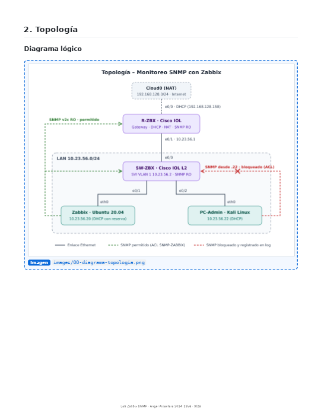

### Topología en PNETLab

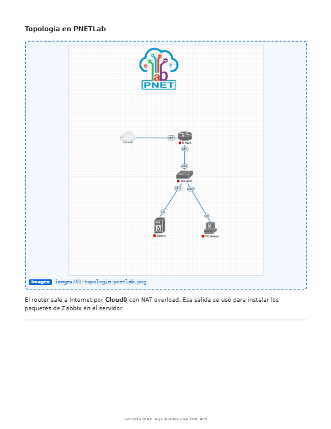

El router sale a Internet por **Cloud0** con NAT overload. Esa salida se usó para instalar los paquetes de Zabbix en el servidor.

---

## 3. Dispositivos y conexiones

| Dispositivo | Imagen / Sistema | Función |
|---|---|---|
| **R-ZBX** | Cisco IOL (IOS 15.4) | Gateway de la LAN, servidor DHCP, NAT y agente SNMP |
| **SW-ZBX** | Cisco IOL L2 (IOS 15.2) | Switch de acceso de la LAN y agente SNMP |
| **Zabbix** | Ubuntu Server 20.04 · Zabbix 6.0.49 | Servidor de monitoreo (cliente DHCP) |
| **PC-Admin** | Kali Linux | Estación de administración y equipo de prueba no autorizado |
| **Cloud0** | Red NAT de PNETLab | Salida a Internet |

| Origen | Interfaz | Destino | Interfaz |
|---|---|---|---|
| R-ZBX | e0/0 | Cloud0 | — |
| R-ZBX | e0/1 | SW-ZBX | e0/0 |
| SW-ZBX | e0/1 | Zabbix | eth0 |
| SW-ZBX | e0/2 | PC-Admin | eth0 |

---

## 4. Direccionamiento IP

Red LAN: **10.23.56.0/24**, tomada de la matrícula 2024-**2356**.

| Dispositivo | Interfaz | Dirección IP | Asignación |
|---|---|---|---|
| R-ZBX | e0/0 (WAN) | 192.168.128.158/24 | DHCP desde Cloud0 |
| R-ZBX | e0/1 (LAN) | 10.23.56.1/24 | Estática (gateway) |
| SW-ZBX | VLAN 1 | 10.23.56.2/24 | Estática (gestión) |
| Zabbix | eth0 | 10.23.56.20/24 | DHCP con reserva |
| PC-Admin | eth0 | 10.23.56.22/24 | DHCP dinámico |

| Parámetro DHCP | Valor |
|---|---|
| Pool | `LAN-2356` → 10.23.56.0/24 |
| Gateway | 10.23.56.1 |
| DNS | 8.8.8.8, 1.1.1.1 |
| Excluidas | 10.23.56.1 – 10.23.56.20 (infraestructura) |
| Reserva | `ZABBIX-SRV` → 10.23.56.20 para el Client-ID `0150.8a1d.0052.00` |

---

## 5. Configuración del router R-ZBX

### 5.1 Interfaces y NAT

```
interface e0/0
 description WAN-Cloud0
 ip address dhcp
 ip nat outside
 no shutdown
!
interface e0/1
 description LAN-SW-ZBX
 ip address 10.23.56.1 255.255.255.0
 ip nat inside
 no shutdown
!
access-list 1 permit 10.23.56.0 0.0.0.255
ip nat inside source list 1 interface e0/0 overload
```

### 5.2 Servidor DHCP de la LAN

```
ip dhcp excluded-address 10.23.56.1 10.23.56.20
!
ip dhcp pool LAN-2356
 network 10.23.56.0 255.255.255.0
 default-router 10.23.56.1
 dns-server 8.8.8.8 1.1.1.1
```

### 5.3 Reserva DHCP para el servidor Zabbix

El servidor Zabbix es **cliente DHCP**, pero necesita una IP fija porque la ACL de SNMP lo identifica por su dirección. Por eso se creó un pool manual que asocia la `10.23.56.20` a su Client-ID (`01` + MAC `50:8a:1d:00:52:00`):

```
ip dhcp pool ZABBIX-SRV
 host 10.23.56.20 255.255.255.0
 client-identifier 0150.8a1d.0052.00
 default-router 10.23.56.1
 dns-server 8.8.8.8 1.1.1.1
```

### 5.4 SNMP de solo lectura restringido por ACL

```
ip access-list standard SNMP-ZABBIX
 permit host 10.23.56.20
 deny any log
!
snmp-server community ITLA2356-RO RO SNMP-ZABBIX
snmp-server location Lab-ITLA-PNETLab
snmp-server contact Angel Alcantara
```

- `RO`: la comunidad solo permite lectura.
- `SNMP-ZABBIX`: solo el host `10.23.56.20` puede usar la comunidad.
- `deny any log`: cualquier otro intento se bloquea y se registra.

---

## 6. Configuración del switch SW-ZBX

```
interface range e0/1 - 2
 switchport mode access
 switchport access vlan 1
!
interface vlan 1
 ip address 10.23.56.2 255.255.255.0
 no shutdown
!
ip default-gateway 10.23.56.1
ip route 0.0.0.0 0.0.0.0 10.23.56.1
!
ip access-list standard SNMP-ZABBIX
 permit host 10.23.56.20
 deny any log
!
snmp-server community ITLA2356-RO RO SNMP-ZABBIX
snmp-server location Lab-ITLA-PNETLab
snmp-server contact Angel Alcantara
```

Se configuraron tanto `ip default-gateway` como la ruta por defecto, porque algunas imágenes IOL L2 tienen `ip routing` activo y en ese caso ignoran el default-gateway.

---

## 7. Servidor Zabbix

### 7.1 Red: cliente DHCP

Archivo `/etc/netplan/01-netcfg.yaml`:

```yaml
network:
  version: 2
  renderer: networkd
  ethernets:
    eth0:
      dhcp4: yes
      dhcp-identifier: mac
```

`dhcp-identifier: mac` hace que Ubuntu envíe como Client-ID `01` + su MAC. Por defecto Ubuntu 20.04 usa un DUID y no coincidiría con la reserva del router.

### 7.2 Instalación de Zabbix 6.0 LTS

Se instaló **Zabbix 6.0 LTS** con MySQL y Apache, porque Zabbix 7.0 no tiene paquetes de servidor para Ubuntu 20.04. El procedimiento completo está en [`scripts/install_zabbix.sh`](scripts/install_zabbix.sh). Resumen:

```bash
wget https://repo.zabbix.com/zabbix/6.0/ubuntu/pool/main/z/zabbix-release/zabbix-release_latest_6.0+ubuntu20.04_all.deb
dpkg -i zabbix-release_latest_6.0+ubuntu20.04_all.deb
apt update
apt install -y zabbix-server-mysql zabbix-frontend-php zabbix-apache-conf zabbix-sql-scripts zabbix-agent mysql-server snmp
# crear BD zabbix, importar server.sql.gz, poner DBPassword en /etc/zabbix/zabbix_server.conf
systemctl enable --now zabbix-server zabbix-agent apache2
```

Durante la instalación también se generó el locale `en_US.UTF-8`, se ajustó la zona horaria a `America/Santo_Domingo` y se desactivó `snmpd`, para no dejar el puerto 161 abierto en el propio servidor (Zabbix solo consulta SNMP, no lo necesita).

Asistente web, con todos los requisitos en OK:

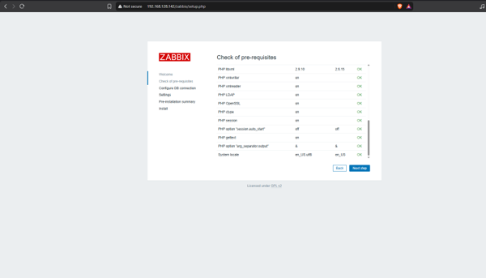

Conexión a la base de datos local:

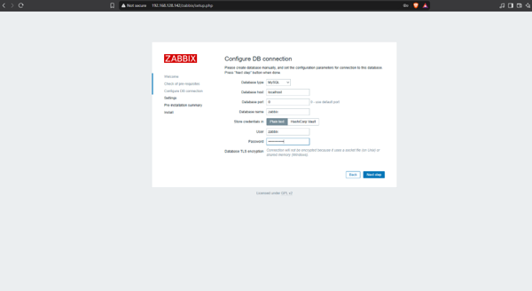

Instalación completada:

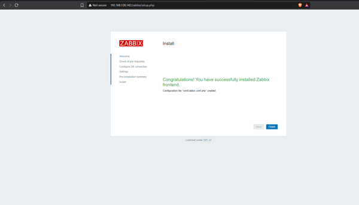

Panel principal, con *Zabbix server is running: Yes*:

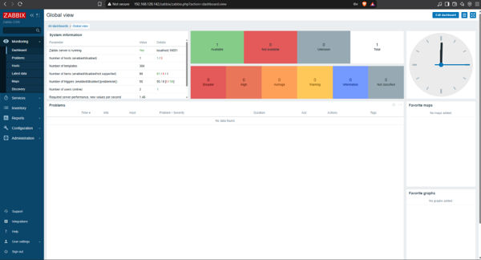

Después de entrar se cambió la contraseña por defecto del usuario `Admin`.

### 7.3 Hosts monitoreados por SNMP

En **Configuration → Hosts → Create host** se agregaron los dos equipos con el template **Cisco IOS by SNMP**, el grupo `Lab-ITLA-2356` y una interfaz SNMPv2 con la comunidad `ITLA2356-RO`.

**R-ZBX** (`10.23.56.1:161`):

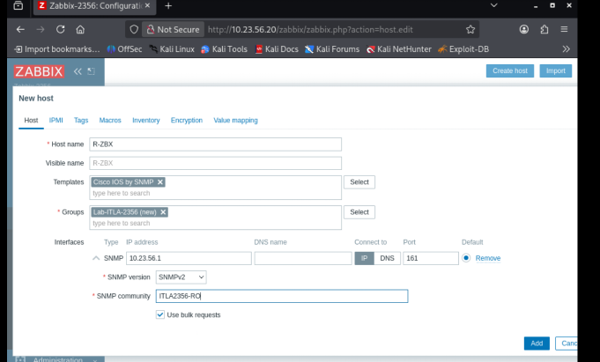

**SW-ZBX** (`10.23.56.2:161`):

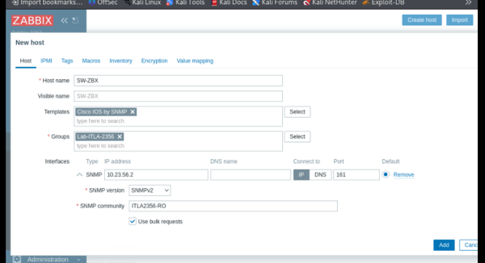

---

## 8. Verificación

### 8.1 DHCP

Asignaciones en el router: la `.20` reservada para Zabbix (Manual) y el resto dinámicas.

```
R-ZBX#show ip dhcp binding
IP address          Client-ID/              Lease expiration        Type
10.23.56.20         0150.8a1d.0052.00       Infinite                Manual
```

El servidor Zabbix recibe la `10.23.56.20` por DHCP (`dynamic`) y alcanza su gateway:

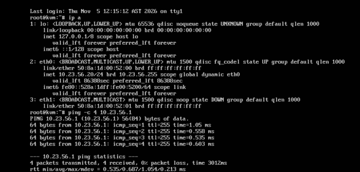

El PC-Admin (Kali) recibe la `10.23.56.22` del pool; se ve en la imagen de la [sección 9](#9-prueba-de-seguridad).

### 8.2 Conectividad e Internet por NAT

```
R-ZBX#show ip interface brief
Interface         IP-Address       OK? Method Status   Protocol
Ethernet0/0       192.168.128.158  YES DHCP   up       up
Ethernet0/1       10.23.56.1       YES NVRAM  up       up

SW-ZBX#ping 8.8.8.8
!!!!!
Success rate is 100 percent (5/5)
```

### 8.3 Consultas SNMP desde el servidor Zabbix

El servidor autorizado obtiene el nombre de los dos equipos:

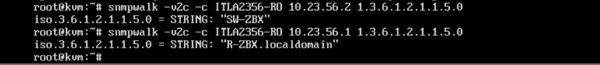

Grupo `system` completo del router: versión de IOS, uptime, contacto y ubicación configurados:

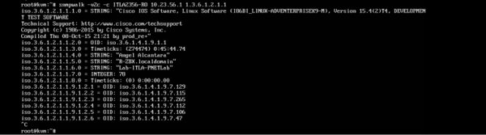

### 8.4 SNMP de solo lectura

Un intento de escritura con `snmpset` es rechazado con **`noAccess`** y el valor no cambia:

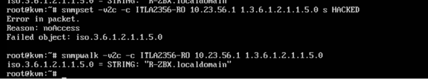

### 8.5 Datos SNMP en Zabbix

Los dos hosts con el indicador **SNMP en verde**:

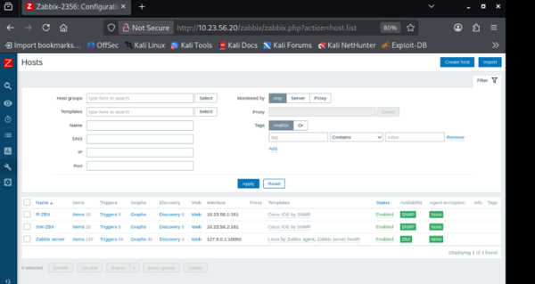

En **Monitoring → Latest data** aparecen disponibilidad del agente SNMP, ping ICMP, tiempo de respuesta y pérdida:

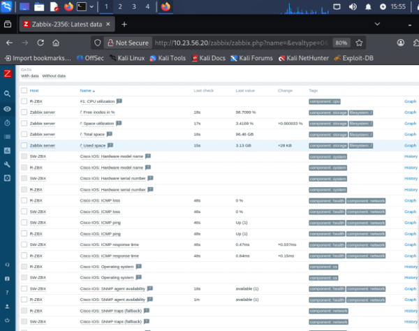

Uptime y datos de interfaces (estado, velocidad, duplex), descubiertos automáticamente:

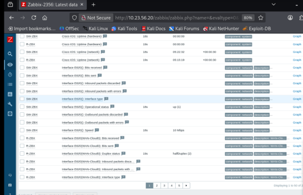

> Los campos de modelo y serial de hardware salen vacíos porque Cisco IOL es un IOS emulado y no reporta esa información. En un equipo físico sí aparecen.

---

## 9. Prueba de seguridad

Desde el **PC-Admin** (`10.23.56.22`), usando **la misma comunidad correcta**, se intentó consultar SNMP al router y al switch. Los dos equipos no responden (`Timeout`), porque la ACL `SNMP-ZABBIX` solo permite al servidor Zabbix:

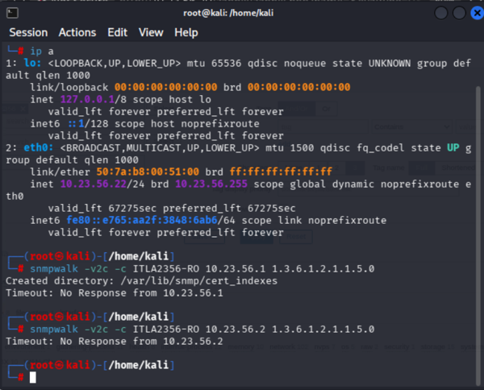

Contadores de la ACL y registro de los intentos bloqueados:

```
R-ZBX#show access-lists SNMP-ZABBIX
Standard IP access list SNMP-ZABBIX
    10 permit 10.23.56.20 (298 matches)
    20 deny   any log (6 matches)

R-ZBX#show logging | include SNMP-ZABBIX
%SEC-6-IPACCESSLOGNP: list SNMP-ZABBIX denied 0 10.23.56.22 -> 0.0.0.0, 1 packet
```

```
SW-ZBX#show access-lists SNMP-ZABBIX
Standard IP access list SNMP-ZABBIX
    10 permit 10.23.56.20 (146 matches)
    20 deny   any log (6 matches)

SW-ZBX#show logging | include SNMP-ZABBIX
%SEC-6-IPACCESSLOGNP: list SNMP-ZABBIX denied 0 10.23.56.22 -> 0.0.0.0, 1 packet
```

**Resultado:**

| Prueba | Origen | Resultado |
|---|---|---|
| Lectura SNMP | Zabbix (`.20`) | Responde |
| Escritura SNMP (`snmpset`) | Zabbix (`.20`) | Rechazada: `noAccess` |
| Lectura SNMP con la comunidad correcta | PC-Admin (`.22`) | Bloqueada: `Timeout` |
| Registro del intento | Router y switch | `%SEC-6-IPACCESSLOGNP ... denied 10.23.56.22` |

La topología cumple su objetivo: el monitoreo funciona solo desde Zabbix, en modo lectura, y cualquier otro intento se bloquea y queda registrado.

> **Nota:** SNMPv2c envía la comunidad en texto claro. En un entorno de producción se recomienda SNMPv3 con autenticación y cifrado (`authPriv`), manteniendo la misma restricción por ACL.

---

## 10. Problemas encontrados y solución

| Problema | Causa | Solución |
|---|---|---|
| Errores `%Error opening tftp://...` en el router | El router arrancó sin startup-config y activó el *autoinstall* | Guardar la configuración (`write memory`) y reiniciar (`reload`) |
| Zabbix 7.0 no se instalaba en Ubuntu 20.04 | No hay paquetes de servidor 7.0 para Ubuntu 20.04 | Usar **Zabbix 6.0 LTS** |
| El servidor Zabbix no recibía la `.20` | Ubuntu enviaba un DUID como Client-ID | `dhcp-identifier: mac` en netplan |
| La reserva dejó de funcionar | PNETLab le generó una MAC nueva al nodo | Actualizar el `client-identifier` y fijar la *First MAC* del nodo |
| El router rechazó la reserva nueva | Existía un binding automático del mismo cliente | `clear ip dhcp binding` antes de crear el pool manual |
| `snmpwalk ... sysName` daba *Unknown Object Identifier* | Ubuntu no tiene instalados los archivos MIB | Usar el OID numérico `1.3.6.1.2.1.1.5.0` |

---

## 11. Estructura del repositorio

```
Lab-Zabbix-SNMP-2356/
├── README.md
├── images/                      # Diagrama y capturas usadas en este README
├── configs/
│   ├── R-ZBX_running-config.txt
│   └── SW-ZBX_running-config.txt
└── scripts/
    ├── R-ZBX_comandos.txt       # Comandos aplicados en el router
    ├── SW-ZBX_comandos.txt      # Comandos aplicados en el switch
    ├── install_zabbix.sh        # Instalación de Zabbix 6.0 LTS
    └── 01-netcfg.yaml           # Netplan del servidor Zabbix
```

---

## 12. Anexos: running-configs y scripts

<details>
<summary><b>R-ZBX – running-config</b></summary>

```
R-ZBX#show running-config
Building configuration...

Current configuration : 1670 bytes
!
! Last configuration change at 17:01:30 AST Thu Nov 5 2026
!
version 15.4
service timestamps debug datetime msec
service timestamps log datetime msec
no service password-encryption
!
hostname R-ZBX
!
boot-start-marker
boot-end-marker
!
!
!
no aaa new-model
clock timezone AST -4 0
mmi polling-interval 60
no mmi auto-configure
no mmi pvc
mmi snmp-timeout 180
!
!
!
!
!
!
!
!


!
ip dhcp excluded-address 10.23.56.1 10.23.56.20
!
ip dhcp pool LAN-2356
 network 10.23.56.0 255.255.255.0
 default-router 10.23.56.1
 dns-server 8.8.8.8 1.1.1.1
!
ip dhcp pool ZABBIX-SRV
 host 10.23.56.20 255.255.255.0
 client-identifier 0150.8a1d.0052.00
 default-router 10.23.56.1
 dns-server 8.8.8.8 1.1.1.1
!
!
!
no ip domain lookup
ip cef
no ipv6 cef
!
multilink bundle-name authenticated
!
!
!
!
!
!
!
!
!
redundancy
!
!
!
!
!
!
!
!
!
!
!
!
!
!
!
interface Ethernet0/0
 description WAN-Cloud0
 ip address dhcp
 ip nat outside
 ip virtual-reassembly in
!
interface Ethernet0/1
 description LAN-SW-ZBX
 ip address 10.23.56.1 255.255.255.0
 ip nat inside
 ip virtual-reassembly in
!
interface Ethernet0/2
 no ip address
 shutdown
!
interface Ethernet0/3
 no ip address
 shutdown
!
ip forward-protocol nd
!
!
no ip http server
no ip http secure-server
ip nat inside source list 1 interface Ethernet0/0 overload
!
ip access-list standard SNMP-ZABBIX
 permit 10.23.56.20
 deny   any log
!
!
snmp-server community ITLA2356-RO RO SNMP-ZABBIX
snmp-server location Lab-ITLA-PNETLab
snmp-server contact Angel Alcantara
!
access-list 1 permit 10.23.56.0 0.0.0.255
!
control-plane
!
!
!
!
!
!
!
!
line con 0
 logging synchronous
line aux 0
line vty 0 4
 login
 transport input none
!
!
end
```

</details>

<details>
<summary><b>SW-ZBX – running-config</b></summary>

```
SW-ZBX#show running-config
Building configuration...

Current configuration : 1128 bytes
!
! Last configuration change at 17:01:35 AST Thu Nov 5 2026
!
version 15.2
service timestamps debug datetime msec
service timestamps log datetime msec
no service password-encryption
service compress-config
!
hostname SW-ZBX
!
boot-start-marker
boot-end-marker
!
!
!
no aaa new-model
clock timezone AST -4 0
!
!
!
!
!
!
!
!
no ip domain-lookup
ip cef
no ipv6 cef
!
!
!
spanning-tree mode rapid-pvst
spanning-tree extend system-id
!
vlan internal allocation policy ascending
!
!
!
!
!
!
!
!
!
!
!
!
!
!
interface Ethernet0/0
!
interface Ethernet0/1
 switchport mode access
!
interface Ethernet0/2
 switchport mode access
!
interface Ethernet0/3
!
interface Vlan1
 ip address 10.23.56.2 255.255.255.0
!
ip default-gateway 10.23.56.1
ip forward-protocol nd
!
no ip http server
no ip http secure-server
!
ip route 0.0.0.0 0.0.0.0 10.23.56.1
!
ip access-list standard SNMP-ZABBIX
 permit 10.23.56.20
 deny   any log
!
!
!
!
snmp-server community ITLA2356-RO RO SNMP-ZABBIX
snmp-server location Lab-ITLA-PNETLab
snmp-server contact Angel Alcantara
!
control-plane
!
!
line con 0
 logging synchronous
line aux 0
line vty 0 4
!
!
end
```

</details>

<details>
<summary><b>Comandos aplicados en R-ZBX</b></summary>

```
! =====================================================================
! R-ZBX - Comandos aplicados (Cisco IOL)
! Direccionamiento, NAT, servidor DHCP con reserva y SNMP de solo lectura
! =====================================================================
enable
configure terminal
hostname R-ZBX
no ip domain-lookup
no aaa new-model
no service config
clock timezone AST -4
!
interface e0/0
 description WAN-Cloud0
 ip address dhcp
 ip nat outside
 no shutdown
!
interface e0/1
 description LAN-SW-ZBX
 ip address 10.23.56.1 255.255.255.0
 ip nat inside
 no shutdown
exit
!
! --- Servidor DHCP de la LAN ---
ip dhcp excluded-address 10.23.56.1 10.23.56.20
ip dhcp pool LAN-2356
 network 10.23.56.0 255.255.255.0
 default-router 10.23.56.1
 dns-server 8.8.8.8 1.1.1.1
exit
!
! --- Reserva para el servidor Zabbix (Client-ID = 01 + MAC) ---
ip dhcp pool ZABBIX-SRV
 host 10.23.56.20 255.255.255.0
 client-identifier 0150.8a1d.0052.00
 default-router 10.23.56.1
 dns-server 8.8.8.8 1.1.1.1
exit
!
! --- NAT overload hacia Cloud0 ---
access-list 1 permit 10.23.56.0 0.0.0.255
ip nat inside source list 1 interface e0/0 overload
!
! --- SNMP solo lectura, restringido al servidor Zabbix ---
ip access-list standard SNMP-ZABBIX
 permit host 10.23.56.20
 deny any log
exit
snmp-server community ITLA2356-RO RO SNMP-ZABBIX
snmp-server location Lab-ITLA-PNETLab
snmp-server contact Angel Alcantara
end
write memory
```

</details>

<details>
<summary><b>Comandos aplicados en SW-ZBX</b></summary>

```
! =====================================================================
! SW-ZBX - Comandos aplicados (Cisco IOL L2)
! IP de gestión y SNMP de solo lectura
! =====================================================================
enable
configure terminal
hostname SW-ZBX
no ip domain-lookup
no aaa new-model
clock timezone AST -4
!
interface range e0/1 - 2
 switchport mode access
 switchport access vlan 1
exit
!
! --- IP de gestión ---
interface vlan 1
 ip address 10.23.56.2 255.255.255.0
 no shutdown
exit
ip default-gateway 10.23.56.1
ip route 0.0.0.0 0.0.0.0 10.23.56.1
!
! --- SNMP solo lectura, restringido al servidor Zabbix ---
ip access-list standard SNMP-ZABBIX
 permit host 10.23.56.20
 deny any log
exit
snmp-server community ITLA2356-RO RO SNMP-ZABBIX
snmp-server location Lab-ITLA-PNETLab
snmp-server contact Angel Alcantara
end
write memory
```

</details>

<details>
<summary><b>Netplan del servidor Zabbix – 01-netcfg.yaml</b></summary>

```yaml
# /etc/netplan/01-netcfg.yaml - Servidor Zabbix
# Cliente DHCP. dhcp-identifier: mac hace que el Client-ID sea 01 + MAC,
# para que coincida con la reserva del router (client-identifier 0150.8a1d.0052.00).
network:
  version: 2
  renderer: networkd
  ethernets:
    eth0:
      dhcp4: yes
      dhcp-identifier: mac
```

</details>

<details>
<summary><b>Script de instalación – install_zabbix.sh</b></summary>

```bash
#!/usr/bin/env bash
# =============================================================================
# install_zabbix.sh
# Instalación de Zabbix 6.0 LTS (MySQL + Apache) en Ubuntu Server 20.04
# Laboratorio: Monitoreo SNMP con Zabbix - Angel Alcantara (2024-2356) - ITLA
#
# Uso:  sudo bash install_zabbix.sh
# La contraseña de la base de datos se pide al ejecutar, no se guarda en el repo.
# =============================================================================
set -euo pipefail

if [[ $EUID -ne 0 ]]; then
  echo "Ejecuta el script como root: sudo bash $0"
  exit 1
fi

read -rsp "Contraseña para el usuario 'zabbix' de MySQL: " DB_PASS; echo

echo "[1/7] Repositorio oficial de Zabbix 6.0 LTS para Ubuntu 20.04"
# Zabbix 7.0 no tiene paquetes de servidor para Ubuntu 20.04, por eso se usa 6.0 LTS
wget -q https://repo.zabbix.com/zabbix/6.0/ubuntu/pool/main/z/zabbix-release/zabbix-release_latest_6.0+ubuntu20.04_all.deb
dpkg -i zabbix-release_latest_6.0+ubuntu20.04_all.deb
apt update

echo "[2/7] Paquetes: servidor, frontend, Apache, agente, MySQL y herramientas SNMP"
apt install -y zabbix-server-mysql zabbix-frontend-php zabbix-apache-conf \
  zabbix-sql-scripts zabbix-agent mysql-server snmp

echo "[3/7] Locale requerido por el frontend y zona horaria de RD"
locale-gen en_US.UTF-8
timedatectl set-timezone America/Santo_Domingo

echo "[4/7] Base de datos y usuario"
mysql <<SQL
CREATE DATABASE IF NOT EXISTS zabbix CHARACTER SET utf8mb4 COLLATE utf8mb4_bin;
CREATE USER IF NOT EXISTS 'zabbix'@'localhost' IDENTIFIED BY '${DB_PASS}';
GRANT ALL PRIVILEGES ON zabbix.* TO 'zabbix'@'localhost';
SET GLOBAL log_bin_trust_function_creators = 1;
SQL

echo "[5/7] Importando el esquema (tarda unos minutos, no muestra salida)"
zcat /usr/share/zabbix-sql-scripts/mysql/server.sql.gz | \
  mysql --default-character-set=utf8mb4 -uzabbix -p"${DB_PASS}" zabbix
mysql -e "SET GLOBAL log_bin_trust_function_creators = 0;"
mysql -e "SELECT COUNT(*) AS tablas FROM information_schema.tables WHERE table_schema='zabbix';"

echo "[6/7] Contraseña de la BD en zabbix_server.conf"
sed -i "s/^# DBPassword=.*/DBPassword=${DB_PASS}/" /etc/zabbix/zabbix_server.conf
grep -q "^DBPassword=" /etc/zabbix/zabbix_server.conf || echo "DBPassword=${DB_PASS}" >> /etc/zabbix/zabbix_server.conf

echo "[7/7] Servicios"
# snmpd se instala como dependencia; el servidor solo consulta SNMP, así que se desactiva
systemctl disable --now snmpd || true
systemctl restart zabbix-server zabbix-agent apache2
systemctl enable zabbix-server zabbix-agent apache2
systemctl --no-pager status zabbix-server | head -n 5

echo
echo "Listo. Abre http://<IP_DEL_SERVIDOR>/zabbix y completa el asistente web."
echo "Usuario inicial: Admin  (cambia la contraseña por defecto al entrar)"
```

</details>
